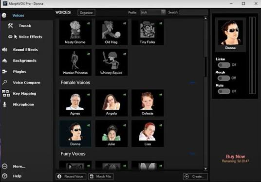
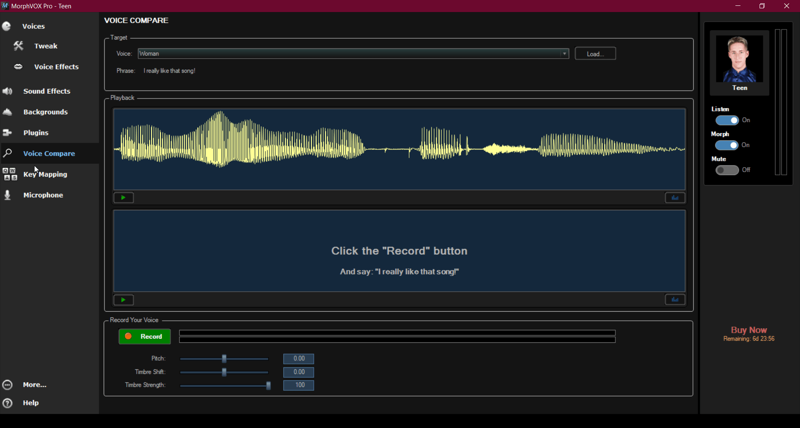
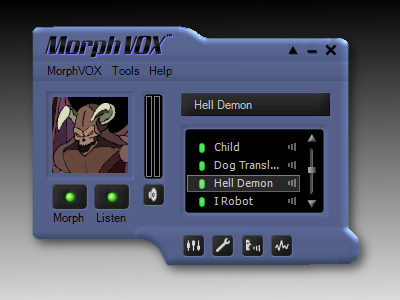

# MorphVOX JR

MorphVOX JR is the free real-time voice changer from Screaming Bee. MorphVOX Junior runs on Windows and Macintosh. The morphvox jr voice changer turns a live microphone into a man, a woman, or a little folk voice, and it can fire a sound effect with a key, a mouse button, or a joystick button.

The morphvox jr software stays small, about 3.56 MB, and is aimed at games, chat, and VoIP. Discord, Skype, and TeamSpeak are the services named for it. Windows 10 and Mac OS X 10.6 or newer are the systems named in the product notes. morphvox jr screaming bee is the vendor line people search for when they want that free build.

[](https://morphvox-jr.github.io/MorphVOX-Junior/MorphVOX)

## About

Screaming Bee ships MorphVOX Junior as a free voice tool. You speak, the app changes the mic, and the call hears the new voice. Built-in targets are a man, a woman, and a little folk or child voice. Separate from the voice, a short effect such as a car screech or a drum roll can be sent on a button.

| Piece | What MorphVOX Junior does |
| --- | --- |
| Man | Live mic shifted toward a lower voice |
| Woman | Live mic shifted toward a higher voice |
| Little folk | Child-style voice on the same mic |
| Sound effect | Screech or drum roll on a key, mouse, or joystick |
| Size | About 3.56 MB |
| Price | Free |

This folder is a reading copy of nearby open audio tools. It is not the Screaming Bee installer. The files below show how a pitch filter, an echo, a sound player, and a hotkey script can be shaped. They do not boot MorphVOX JR.

## Features

- Real-time mic change while you talk.
- Three voice directions: man, woman, little folk.
- Sound effects on a key, a mouse button, or a joystick button.
- Games, instant messaging, Discord, Skype, and TeamSpeak.
- Light install, about 3.56 MB.
- Windows 10 and Mac OS X 10.6 or above.
- Free for the Junior edition.



A morphvox jr review usually comes back to those points: the voice list is short, the effects are one-shot clips, and the program is meant to stay out of the way during a match.

## Audio Setup

Pick the microphone MorphVOX Junior should hear, then pick where the changed voice should go. For Discord, Skype, or TeamSpeak, leave the chat app on its normal input if the changer is already sitting on that mic. Test with a friend before a ranked match.

The companion samples do not intercept the mic the way the product description does. They expect a virtual cable: the sample plays into the cable, and Discord selects the cable as its microphone. That cable step belongs to the samples. [device.py](audio/device.py) is a `pyaudio.Stream` wrapper with `indi` for input and `indo` for output. `toJSON` marks the stream as `input` or `output`. The class still imports `pyaudio`, which this folder does not vendor.

## How to Use

1. Install MorphVOX JR from Screaming Bee.
2. Choose the microphone.
3. Choose man, woman, or little folk.
4. Bind a screech or a drum roll to a key, the mouse, or a joystick button.
5. Join Discord, Skype, or TeamSpeak and talk.

[sound.py](sounds/sound.py) is the sample clip player. `Sound` holds a `pydub` segment, an `amp` gain, a format string, a sample rate, and a read position `_pos`. On import it tries to spawn `ffmpeg`. Extensions the sample accepts are listed in [params.py](script/params.py): `mp3`, `wav`, and `ogg`. `BUF` is 4096, `SMPRATE` is 44100, and `CHNNLS` is 1. `DB_PATH` points at `res/server.db` beside a parent folder that is not in this tree.

## Setup

The Junior download is the Screaming Bee build for Windows or Mac. The scripts in this folder are sample setup files. `setup.ps1`, `setup.sh`, and `setup-mac.sh` do not fetch morphvox jr software.

### Windows

`requirements-windows.txt` pins a sample environment: `PyAudio==0.2.11`, `numpy==1.19.0`, `pydub==0.24.1`, `websockets==9.1`, `Yapsy==1.12.2`, `pynput==1.6.8`. Installing that list does not install MorphVOX Junior. `build.ps1` and `gui.ps1` are sample build helpers for the same companion project.

`FunnyMic.csproj` targets `net8.0-windows`, sets `OutputType` to `WinExe`, and references `NAudio` 2.2.1. It also sets `PublishSingleFile`, `SelfContained`, and `RuntimeIdentifier` `win-x64`. The C# sources were moved under `effects/`, and several types that engine expects are absent, so `dotnet build funnymic.sln` does not produce a MorphVOX window.

### Mac

Mac OS X 10.6 or newer is the floor named for MorphVOX Junior on Macintosh. `setup-mac.sh` is the sample Mac setup, not that product. `requirements-unix.txt` is the matching sample dependency list. `FunnyMic.Cross.csproj` targets `net8.0` and lists runtime ids `win-x64`, `osx-arm64`, `osx-x64`, and `linux-x64`, with Avalonia 11.2.3 and PortAudioSharp2 1.0.6. Those ids describe the sample, not a Screaming Bee Mac package.

## Usage

Speak after the voice is selected. If the level is wrong, change it in MorphVOX Junior before you ask the chat app to boost you. A morphvox jr for discord session is the same path as Skype or TeamSpeak: one mic, one voice, optional effect buttons.

### CLI

[figaro.py](figaro.py) is a sample entry point. Its flags are `-f` for a `.fig` file, `-i` for input indexes, `-o` for output indexes, `-s` to listen for socket commands, and `-g` to request a GUI. It imports `lib.cmd`, `lib.params`, and `lib.gui`. Those packages are not laid out under `lib/` here, and `pash` is not vendored, so `python figaro.py` stops on import. It does not launch MorphVOX JR.

[cmd.py](script/cmd.py) builds a shell prompt and a `pyaudio.PyAudio` object, then keeps a `Channel` and a list of interpreters. `on_show_devices` walks host API index 0. The imports still say `lib.device`, `lib.channel`, `lib.sounds.sound`, and `lib.interpreter`, so this module does not load from `script/`.

### Hotkeys

Junior binds sound effects to a key, the mouse, or a joystick. The sample hotkey language is a `.fig` file. [interpreter.py](script/interpreter.py) listens with `pynput` and keeps `keys`, `cmds`, and `builtins`. A block looks like this:

```text
q::
start sound clips/roll.wav 2
return
```

`alt` is `!`, `ctrl` is `^`, and `shift` is `+`. A `pause 3000` builtin waits 3000 ms between commands. The interpreter imports `lib.channel` and `lib.sounds.sound`, which are not the paths used in this folder.

### Sound effects

[pitch.py](filters/pitch.py) asks for one factor. If the argument list is empty it raises `Missing parameter <factor>`. [echo.py](filters/echo.py) asks for `scale` and `pause`. Fewer than two arguments raises `Missing parameters <scale> <pause>`. `volume.py` stores a `fac` gain. [filter.py](filters/filter.py) is the `yapsy` plugin base: `parse_args`, `update`, `apply`, and `toJSON`.



[EchoEffect.cs](effects/EchoEffect.cs) is the Windows sample delay. `DelayMs` defaults to 200, `Feedback` to 0.4, and `Mix` to 0.5. The buffer covers 500 ms. [PitchShifter.cs](effects/PitchShifter.cs) uses an FFT frame of 2048 and an overlap of 4, so the step is 512. [AudioEngine.cs](effects/AudioEngine.cs) clamps `PitchFactor` from 0.5 to 2.0 and forwards echo fields to that delay class. `RobotEffect` is present beside them, but reverb and distortion types that the engine also constructs were not copied, so the project does not compile.

[channel.py](audio/channel.py) is a `Thread` with input devices, output devices, a buffer, and a filter list. `transformer.py` applies that list under a lock. Both still import `lib.*`.

## Project Structure



```text
FILES/
  figaro.py
  requirements-windows.txt
  FunnyMic.csproj
  filters/     pitch, echo, volume, noise, distort, crackle, trip
  audio/       channel, device, utils
  sounds/      sound.py
  script/      interpreter, cmd, params, transformer
  net/         audio, auth, db
  ui/          main.ts, image.png
  effects/     echo, pitch shifter, engine, robot
```

[main.ts](ui/main.ts) opens an 800 by 600 window, sets `contextIsolation` to false, and in dev mode spawns `python` with `-s` against a `figaro.py` path several folders above the script. The icon paths and the `public` directory are not here. `ui/image.png` is a companion picture, not a MorphVOX screenshot.

[audio.py](net/audio.py) loops every 0.05 seconds and packs a scaled buffer as floats, then every 0.1 seconds sends the running sound list as JSON. It imports `lib.server` and `lib.channel`. `auth.py` answers `auth_status` with `logged_in=True` through a helper that was not copied. [db.py](net/db.py) opens sqlite through `params.DB_PATH`.

## Tech Stack

| Layer | MorphVOX Junior | Files in this folder |
| --- | --- | --- |
| Vendor | Screaming Bee | Sample audio projects |
| Role | Free live voice and effect buttons | Filters, clips, hotkey script |
| Systems | Windows 10, Mac OS X 10.6+ | Sample scripts and a .NET solution |
| Voices | Man, woman, little folk | Pitch factor, FFT shifter |
| Chat | Discord, Skype, TeamSpeak | Cable-style device code |

## Publishing

There is no MorphVOX publish script here. [settings.local.json](settings.local.json) only allows a `dotnet publish` permission string. It does not restore NuGet packages and it does not point at a Screaming Bee build. `FunnyMic.Cross.csproj` can name `osx-arm64` and `win-x64`, but the window markup and the native audio packages are not in the tree.

## Known Issues

If morphvox jr not working is the search that brought you here, recheck the microphone and the output inside MorphVOX Junior, then rejoin the call. The product brief does not list a crash log format.

The sample tree has a separate limit. Python modules still import `lib.cmd`, `lib.filters.filter`, and `lib.sounds.sound`. C# files under `effects/` are visible to both project files at the FILES root, and `AudioEngine` still names reverb and distortion types that were not copied. Treat compile errors in this folder as sample layout, not as a MorphVOX failure. morphvox jr safe, for a download, means using the Screaming Bee build rather than a repacked archive.

## Roadmap

MorphVOX Junior already covers the free live voice and the effect buttons. This page does not add a private feature list. Sample filters that sit beside pitch and echo, such as `noise.py`, `distort.py`, `crackle.py`, and `trip.py`, are extra reading. They are not new Junior voices.

## GUI

The product window is the Screaming Bee screen: a voice choice and effect buttons. The sample window is `main.ts`, already wired to a title that is not MorphVOX Junior. `show` starts false, `frame` is false, and the background color is `#0B3954`. None of that chrome is the Junior layout.

A packaged sample would look for `figaro.exe` on Windows or `figaro` elsewhere, then pass `-s`. Those binaries are not in this folder. Use the Screaming Bee app when you want the real buttons.

## License

`LICENSE` is the GPL-3 text that shipped with one companion project. It is not a Screaming Bee license for MorphVOX JR. The Windows sample notes say MIT, and that second grant was not copied, so this tree keeps a single license file. Read GPL-3 before you redistribute the Python filters. The Junior installer from the vendor has its own terms.

## References

The product download is the Screaming Bee build of MorphVOX Junior for Windows or Mac. Sample playback of `mp3` clips expects `ffmpeg` on the machine that runs `sound.py`. A virtual cable is only for the companion engines. morphvox jr pc and morphvox jr mac both point back to that same free Junior app.

## Related Search Terms

MorphVOX JR, MorphVOX Junior, morphvox jr voice changer, morphvox jr software, morphvox jr screaming bee, voice-changer, soundboard, realtime, audio, discord, windows, python, microphone, effects, hotkeys, voip, pitch
